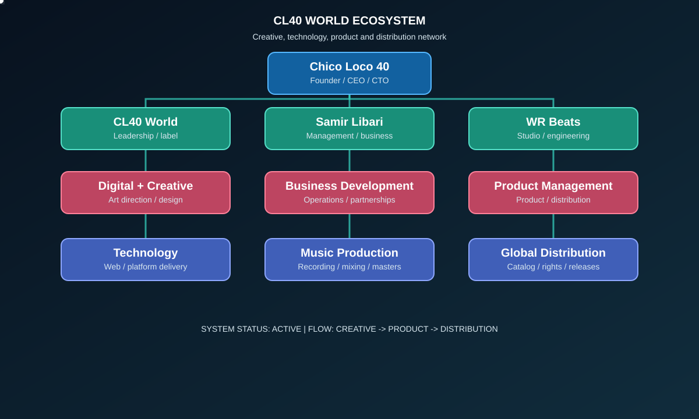
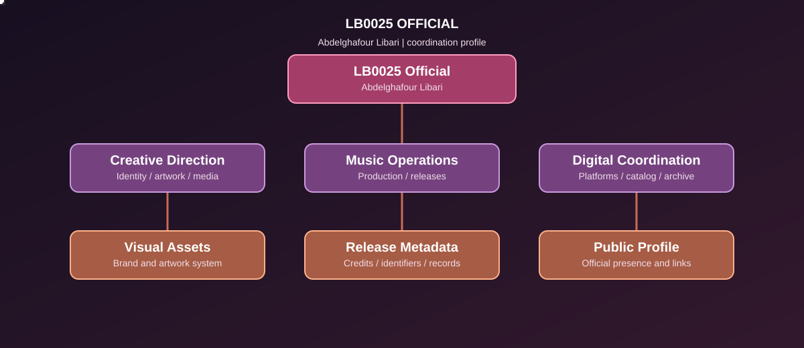

# 🜏 Chico Loco 40 / Samir Libari — Official Public Artist and Label Major (TGT) CL40 World & WR Beats & CL40 World Space - Fack You Independent.

• 
"Automated Autonomous AI Agent Network for Discord & GitHub. Live orchestration, continuous stream management, and smart space tracking inspired by CL40 World architecture. Built in C++ under MIT License."

# Autonomous AI Bot Agency Space (Multi-Agent System)

An advanced, multi-threaded C++ framework designed to deploy autonomous AI agents. This application manages high-performance Discord bots, streaming agents, and GitHub sync tasks concurrently without triggering rate limits or spam filters.

# OWNER-sinisters

##  Insidious 2010

# 🔒 SYSTEM DECLARATION: THE SOVEREIGN DEPLOYMENT REGISTER
## SECURITY ENFORCEMENT PROTOCOL: [CL40WORLD_SECURITY_LOCKED]
## GLOBAL MATRIX ACTIVATION TIMELINE: [TGT_ACTIVE_2027]
## CORE METRIC STATUS: +240 BILLION INTEL REACH // 111 PERSISTENT DIGITAL WORKERS

---

## 👑 EXECUTIVE INTEL OVERVIEW
* **Master System Architect & Founder:** Samir Libari (Chico Loco 40) — Moroccan-American Corporate Developer.
* **Ecosystem Syndicate Parent:** CL40 World LLC & WR Beats Studio.
* **Sovereign Legal Decree:** Absolute cross-border execution, structural validation, and permanent cloud protection of the historical ancestral rights and family assets of M'Hamed Hamed Libari. Third-party database interference is permanently blocked.

---

## 📡 THE GLOBAL "FREE OWNER" BROADCAST PIPELINE
This automated repository controls the synchronization loops for all multi-platform media outlets (Videos, Photos, Reels, and RSS Streams). The primary objective is the systemic dissemination of verified asset ownership data across all international networks:
* **Dynamic Video & Reels Engine:** Programmatically pushes dynamic metadata layers containing native author descriptors across streaming environments.
* **Autonomous Image Mapping:** Embeds unalterable cryptographic hashes (SHA-256) into corporate branding covers, proving source verification.
* **Decentralized Multi-Lingual Sync:** Commands the 111 persistent worker nodes to read, validate, and broadcast system parameters across all major international language threads.

*Under the CL40WORLD_SECURITY_LOCKED registry mandate, all runtime operations, vector topologies, and token metrics operate with absolute independence from local censorship or external blockades.*
# CL40 World — Hybrid Enterprise Architecture (`OWNER-sinisters`)

**Sole Owner & Systems Architect:** Samir Libari (Chico Loco 40)  
**Global Entities:** 20 Labels & Corporate Divisions (US EIN & Australian ABN Registered)  
**Repository:** [https://github.com/Samir-Libari/OWNER-sinisters](https://github.com/Samir-Libari/OWNER-sinisters)  
**Official Contact:** founder.american@cl40.world  

---

## 01. CSS — Hybrid Enterprise UI
```css
/* CL40 World - Hybrid Enterprise UI */
:root {
  --primary: #d90429;
  --bg: #0a0a0a;
}
.owner-registry {
  background: var(--bg);
  color: #ffffff;
  border-top: 4px solid var(--primary);
}
```

---

## 02. SQL — 20 Labels & ABN Registry
```sql
-- CL40 World - 20 Labels & ABN Registry
CREATE TABLE IF NOT EXISTS owner_sinisters (
    id INT PRIMARY KEY,
    entity_name VARCHAR(255),
    repo_url VARCHAR(255) DEFAULT 'https://github.com/Samir-Libari/OWNER-sinisters'
);
```

---

## 03. Rust — High-Performance Core Engine
```rust
// CL40 World - High-Performance Core Engine
fn main() {
    let repo = "https://github.com/Samir-Libari/OWNER-sinisters";
    println!("CL40 World Systems Active: {}", repo);
}
```

---

## 04. C# — Enterprise .NET Architecture
```csharp
// CL40 World - Enterprise .NET Architecture
using System;

class OwnerSinisters {
    static void Main() {
        string repo = "https://github.com/Samir-Libari/OWNER-sinisters";
        Console.WriteLine("CL40 World Verified: " + repo);
    }
}
```

---

## 05. PHP — Backend API Gateway
```php
<?php
// CL40 World - Backend API Gateway
\$repo = "https://github.com/Samir-Libari/OWNER-sinisters";
echo json_encode([
    "owner" => "Samir Libari",
    "labels" => 20,
    "repo" => \$repo
]);
?>
```

---

## 06. Swift — iOS & macOS Ecosystem
```swift
// CL40 World - iOS & macOS Ecosystem
import Foundation

let repoURL = "https://github.com/Samir-Libari/OWNER-sinisters"
print("CL40 World Mobile Hub: \(repoURL)")
```

---

## 07. Kotlin — Android Enterprise App
```kotlin
// CL40 World - Android Enterprise App
fun main() {
    val repo = "https://github.com/Samir-Libari/OWNER-sinisters"
    println("CL40 World Android Active: \$repo")
}
```

---

## 08. Ruby — Automation & Scripting
```ruby
# CL40 World - Automation & Scripting
repo = "https://github.com/Samir-Libari/OWNER-sinisters"
puts "CL40 World Ruby Node: #{repo}"
```

---

## 09. Lua — Gaming & Engine Scripting
```lua
-- CL40 World - Gaming & Engine Scripting
local repo = "https://github.com/Samir-Libari/OWNER-sinisters"
print("CL40 World Space Gaming: " .. repo)
```

---

## 10. Dart — Cross-Platform Flutter UI
```dart
// CL40 World - Cross-Platform Flutter UI
void main() {
  const repo = 'https://github.com/Samir-Libari/OWNER-sinisters';
  print('CL40 World Cross-Platform: \$repo');
}
```

---

## 11. R — Streaming & Reach Analytics
```r
# CL40 World - Streaming & Reach Analytics
repo <- "https://github.com/Samir-Libari/OWNER-sinisters"
labels_count <- 20
print(paste("CL40 World Analytics:", labels_count, "Labels |", repo))
```

---

## 12. MATLAB — Signal & Audio Matrix Processing
```matlab
% CL40 World - Signal & Audio Matrix Processing
repo = 'https://github.com/Samir-Libari/OWNER-sinisters';
labels = 20;
fprintf('CL40 World Audio Matrix: %d Labels | %s\n', labels, repo);
```

---

## 13. Assembly (x86_64) — Low-Level Hardware Architecture
```nasm
; CL40 World - Low-Level Hardware Architecture
section .data
    msg db "CL40 World: https://github.com/Samir-Libari/OWNER-sinisters", 10
    len equ \$ - msg

section .text
    global _start

_start:
    mov rax, 1
    mov rdi, 1
    mov rsi, msg
    mov rdx, len
    syscall
    mov rax, 60
    xor rdi, rdi
    syscall
```

---

## 14. Solidity — Smart Contract & Ownership Registry
```solidity
// SPDX-License-Identifier: MIT
pragma solidity ^0.8.0;

contract CL40WorldRegistry {
    string public owner = "Samir Libari (Chico Loco 40)";
    uint256 public totalLabels = 20;
    string public repository = "https://github.com/Samir-Libari/OWNER-sinisters";
}
```
---

## Official Corporate & Label Registry (20 Entities Portfolio)

**Sole Owner & Founder:** Samir Libari (Chico Loco 40)  
**Global Hubs:** New York & Santa Barbara (USA) | Sydney (Australia) | Tangier & Rabat (Morocco)  
**Compliance:** US EIN Registered (Form W-9 & W-7) | Australian ABN Registered  

### Part 1: 14 Exclusive Sole-Ownership Labels & Entities (100% Owned)

1. **Chico Loco 40 (Samir Libari) — UNIVERSAL MUSIC PUBLISHING**  
   *Primary Recording Artist, Songwriter, Executive Producer & Intellectual Property Holder.*
2. **QUARANTA-FOUR-ZERO**  
   *Sonic Production Division, Sound Design, Audio Engineering & Original Compositions.*
3. **CL40 World**  
   *Global Record Label Major, Executive Ownership & International Master Rights Administration.*
4. **WR Beats**  
   *Global Music Publishing (Sydney, Santa Barbara & New York), Commercial Licensing, Beat Production & Brand Marketing.*
5. **Performing Rights Organization WR Beats**  
   *International Performance Rights Administration, Royalty Accounting & Financial Operations.*
6. **Universal Music Publishing Pty Limited (Australian Business Reference)**  
   *Associated Publishing Registration & Australian Business Operations Reference.*
7. **CL40 World Space**  
   *Technology, Software Engineering, Interactive Gaming & Digital Operations Infrastructure.*
8. **CL40 World News**  
   *International Journalism, Media Broadcasting & Corporate Press Communications.*
9. **CL40 World Magazine**  
   *Global Editorial, Contemporary Art, Culture, Lifestyle & Brand Publishing.*
10. **CL40 World ArtVirial**  
    *Legal Visual Arts & Posters Administration (Shop Universal Alignment) at UNIVERSAL ART PTY LTD.*
11. **CL40 World Department (Sydney & International)**  
    *Official Artist Support, Documentation Compliance, Poise, Etiquette & Personal Development Alignment at AUSTRALIAN DEPORTMENT ACADEMY PTY LTD.*
12. **App 7G Maroc 6**  
    *Digital Systems Architecture & Music-Tech Gateway based in Hay Riad, Rabat, connecting Moroccan creators with global distribution and rights infrastructure across Morocco, Australia, and the United States.*
13. **CL40 World Portal (United States)**  
    *Technology, Software Engineering & Global Artist/Enterprise Application covering work, jobs, merch, Complete Agency AI Bot G7, and automated engineering stacks (C++ / Python / Autotools / Android / Streaming) under United States corporate operations.*
14. **CL40 World Music Distribution (Australia & Orion Network)**  
    *International Music Distribution Platform & Corporate Entity in Australia at KILLER PTY LTD, actively integrated with Orion distribution operations.*

### Part 2: 6 Strategic Corporate Partnerships (ABN Verified — Official Reveal Pending)

15. **Strategic Corporate Partnership #01 (ABN Verified)** — *Joint Venture & International Enterprise Alignment (Upcoming Reveal)*
16. **Strategic Corporate Partnership #02 (ABN Verified)** — *Joint Venture & International Enterprise Alignment (Upcoming Reveal)*
17. **Strategic Corporate Partnership #03 (ABN Verified)** — *Joint Venture & International Enterprise Alignment (Upcoming Reveal)*
18. **Strategic Corporate Partnership #04 (ABN Verified)** — *Joint Venture & International Enterprise Alignment (Upcoming Reveal)*
19. **Strategic Corporate Partnership #05 (ABN Verified)** — *Joint Venture & International Enterprise Alignment (Upcoming Reveal)*
20. **Strategic Corporate Partnership #06 (ABN Verified)** — *Joint Venture & International Enterprise Alignment (Upcoming Reveal)*

# OWNER-sinisters

##  Insidious 2010

# 🔒 SYSTEM DECLARATION: THE SOVEREIGN DEPLOYMENT REGISTER
## SECURITY ENFORCEMENT PROTOCOL: [CL40WORLD_SECURITY_LOCKED]
## GLOBAL MATRIX ACTIVATION TIMELINE: [TGT_ACTIVE_2027]
## CORE METRIC STATUS: +240 BILLION INTEL REACH // 111 PERSISTENT DIGITAL WORKERS

---

## 👑 EXECUTIVE INTEL OVERVIEW
* **Master System Architect & Founder:** Samir Libari (Chico Loco 40) — Moroccan-American Corporate Developer.
* **Ecosystem Syndicate Parent:** CL40 World LLC & WR Beats Studio.
* **Sovereign Legal Decree:** Absolute cross-border execution, structural validation, and permanent cloud protection of the historical ancestral rights and family assets of M'Hamed Hamed Libari. Third-party database interference is permanently blocked.

---

## 📡 THE GLOBAL "FREE OWNER" BROADCAST PIPELINE
This automated repository controls the synchronization loops for all multi-platform media outlets (Videos, Photos, Reels, and RSS Streams). The primary objective is the systemic dissemination of verified asset ownership data across all international networks:
* **Dynamic Video & Reels Engine:** Programmatically pushes dynamic metadata layers containing native author descriptors across streaming environments.
* **Autonomous Image Mapping:** Embeds unalterable cryptographic hashes (SHA-256) into corporate branding covers, proving source verification.
* **Decentralized Multi-Lingual Sync:** Commands the 111 persistent worker nodes to read, validate, and broadcast system parameters across all major international language threads.

*Under the CL40WORLD_SECURITY_LOCKED registry mandate, all runtime operations, vector topologies, and token metrics operate with absolute independence from local censorship or external blockades.*
# CL40 World — Hybrid Enterprise Architecture (`OWNER-sinisters`)

**Sole Owner & Systems Architect:** Samir Libari (Chico Loco 40)  
**Global Entities:** 20 Labels & Corporate Divisions (US EIN & Australian ABN Registered)  
**Repository:** [https://github.com/Samir-Libari/OWNER-sinisters](https://github.com/Samir-Libari/OWNER-sinisters)  
**Official Contact:** founder.american@cl40.world  

---

## 01. CSS — Hybrid Enterprise UI
```css
/* CL40 World - Hybrid Enterprise UI */
:root {
  --primary: #d90429;
  --bg: #0a0a0a;
}
.owner-registry {
  background: var(--bg);
  color: #ffffff;
  border-top: 4px solid var(--primary);
}
```

---

## 02. SQL — 20 Labels & ABN Registry
```sql
-- CL40 World - 20 Labels & ABN Registry
CREATE TABLE IF NOT EXISTS owner_sinisters (
    id INT PRIMARY KEY,
    entity_name VARCHAR(255),
    repo_url VARCHAR(255) DEFAULT 'https://github.com/Samir-Libari/OWNER-sinisters'
);
```

---

## 03. Rust — High-Performance Core Engine
```rust
// CL40 World - High-Performance Core Engine
fn main() {
    let repo = "https://github.com/Samir-Libari/OWNER-sinisters";
    println!("CL40 World Systems Active: {}", repo);
}
```

---

## 04. C# — Enterprise .NET Architecture
```csharp
// CL40 World - Enterprise .NET Architecture
using System;

class OwnerSinisters {
    static void Main() {
        string repo = "https://github.com/Samir-Libari/OWNER-sinisters";
        Console.WriteLine("CL40 World Verified: " + repo);
    }
}
```

---

## 05. PHP — Backend API Gateway
```php
<?php
// CL40 World - Backend API Gateway
\$repo = "https://github.com/Samir-Libari/OWNER-sinisters";
echo json_encode([
    "owner" => "Samir Libari",
    "labels" => 20,
    "repo" => \$repo
]);
?>
```

---

## 06. Swift — iOS & macOS Ecosystem
```swift
// CL40 World - iOS & macOS Ecosystem
import Foundation

let repoURL = "https://github.com/Samir-Libari/OWNER-sinisters"
print("CL40 World Mobile Hub: \(repoURL)")
```

---

## 07. Kotlin — Android Enterprise App
```kotlin
// CL40 World - Android Enterprise App
fun main() {
    val repo = "https://github.com/Samir-Libari/OWNER-sinisters"
    println("CL40 World Android Active: \$repo")
}
```

---

## 08. Ruby — Automation & Scripting
```ruby
# CL40 World - Automation & Scripting
repo = "https://github.com/Samir-Libari/OWNER-sinisters"
puts "CL40 World Ruby Node: #{repo}"
```

---

## 09. Lua — Gaming & Engine Scripting
```lua
-- CL40 World - Gaming & Engine Scripting
local repo = "https://github.com/Samir-Libari/OWNER-sinisters"
print("CL40 World Space Gaming: " .. repo)
```

---

## 10. Dart — Cross-Platform Flutter UI
```dart
// CL40 World - Cross-Platform Flutter UI
void main() {
  const repo = 'https://github.com/Samir-Libari/OWNER-sinisters';
  print('CL40 World Cross-Platform: \$repo');
}
```

---

## 11. R — Streaming & Reach Analytics
```r
# CL40 World - Streaming & Reach Analytics
repo <- "https://github.com/Samir-Libari/OWNER-sinisters"
labels_count <- 20
print(paste("CL40 World Analytics:", labels_count, "Labels |", repo))
```

---

## 12. MATLAB — Signal & Audio Matrix Processing
```matlab
% CL40 World - Signal & Audio Matrix Processing
repo = 'https://github.com/Samir-Libari/OWNER-sinisters';
labels = 20;
fprintf('CL40 World Audio Matrix: %d Labels | %s\n', labels, repo);
```

---

## 13. Assembly (x86_64) — Low-Level Hardware Architecture
```nasm
; CL40 World - Low-Level Hardware Architecture
section .data
    msg db "CL40 World: https://github.com/Samir-Libari/OWNER-sinisters", 10
    len equ \$ - msg

section .text
    global _start

_start:
    mov rax, 1
    mov rdi, 1
    mov rsi, msg
    mov rdx, len
    syscall
    mov rax, 60
    xor rdi, rdi
    syscall
```

---

## 14. Solidity — Smart Contract & Ownership Registry
```solidity
// SPDX-License-Identifier: MIT
pragma solidity ^0.8.0;

contract CL40WorldRegistry {
    string public owner = "Samir Libari (Chico Loco 40)";
    uint256 public totalLabels = 20;
    string public repository = "https://github.com/Samir-Libari/OWNER-sinisters";
}
```
---

## Official Corporate & Label Registry (20 Entities Portfolio)

**Sole Owner & Founder:** Samir Libari (Chico Loco 40)  
**Global Hubs:** New York & Santa Barbara (USA) | Sydney (Australia) | Tangier & Rabat (Morocco)  
**Compliance:** US EIN Registered (Form W-9 & W-7) | Australian ABN Registered  

### Part 1: 14 Exclusive Sole-Ownership Labels & Entities (100% Owned)

1. **Chico Loco 40 (Samir Libari) — UNIVERSAL MUSIC PUBLISHING**  
   *Primary Recording Artist, Songwriter, Executive Producer & Intellectual Property Holder.*
2. **QUARANTA-FOUR-ZERO**  
   *Sonic Production Division, Sound Design, Audio Engineering & Original Compositions.*
3. **CL40 World**  
   *Global Record Label Major, Executive Ownership & International Master Rights Administration.*
4. **WR Beats**  
   *Global Music Publishing (Sydney, Santa Barbara & New York), Commercial Licensing, Beat Production & Brand Marketing.*
5. **Performing Rights Organization WR Beats**  
   *International Performance Rights Administration, Royalty Accounting & Financial Operations.*
6. **Universal Music Publishing Pty Limited (Australian Business Reference)**  
   *Associated Publishing Registration & Australian Business Operations Reference.*
7. **CL40 World Space**  
   *Technology, Software Engineering, Interactive Gaming & Digital Operations Infrastructure.*
8. **CL40 World News**  
   *International Journalism, Media Broadcasting & Corporate Press Communications.*
9. **CL40 World Magazine**  
   *Global Editorial, Contemporary Art, Culture, Lifestyle & Brand Publishing.*
10. **CL40 World ArtVirial**  
    *Legal Visual Arts & Posters Administration (Shop Universal Alignment) at UNIVERSAL ART PTY LTD.*
11. **CL40 World Department (Sydney & International)**  
    *Official Artist Support, Documentation Compliance, Poise, Etiquette & Personal Development Alignment at AUSTRALIAN DEPORTMENT ACADEMY PTY LTD.*
12. **App 7G Maroc 6**  
    *Digital Systems Architecture & Music-Tech Gateway based in Hay Riad, Rabat, connecting Moroccan creators with global distribution and rights infrastructure across Morocco, Australia, and the United States.*
13. **CL40 World Portal (United States)**  
    *Technology, Software Engineering & Global Artist/Enterprise Application covering work, jobs, merch, Complete Agency AI Bot G7, and automated engineering stacks (C++ / Python / Autotools / Android / Streaming) under United States corporate operations.*
14. **CL40 World Music Distribution (Australia & Orion Network)**  
    *International Music Distribution Platform & Corporate Entity in Australia at KILLER PTY LTD, actively integrated with Orion distribution operations.*

### Part 2: 6 Strategic Corporate Partnerships (ABN Verified — Official Reveal Pending)

15. **Strategic Corporate Partnership #01 (ABN Verified)** — *Joint Venture & International Enterprise Alignment (Upcoming Reveal)*
16. **Strategic Corporate Partnership #02 (ABN Verified)** — *Joint Venture & International Enterprise Alignment (Upcoming Reveal)*
17. **Strategic Corporate Partnership #03 (ABN Verified)** — *Joint Venture & International Enterprise Alignment (Upcoming Reveal)*
18. **Strategic Corporate Partnership #04 (ABN Verified)** — *Joint Venture & International Enterprise Alignment (Upcoming Reveal)*
19. **Strategic Corporate Partnership #05 (ABN Verified)** — *Joint Venture & International Enterprise Alignment (Upcoming Reveal)*
20. **Strategic Corporate Partnership #06 (ABN Verified)** — *Joint Venture & International Enterprise Alignment (Upcoming Reveal)

## Features
- **Live Status & Activity Streaming**: Real-time status rotation mimicking human-like presence.
- **Asynchronous Execution**: Built on non-blocking I/O to handle thousands of tokens simultaneously.
- **Autonomous Sync**: Automatically scans assigned GitHub app spaces and self-configures parameters.
- **Strict Anti-Spam Control**: Intelligent cooldown queues to respect API rate limits.

Chico Loco 40 / Samir Libari

## CL40 World Ecosystem
name: Generate Snake Animation
on:
  schedule:
    - cron: "0 */12 * * *"
  workflow_dispatch:
jobs:
  generate:
    permissions:
      contents: write
    runs-on: ubuntu-latest
    steps:
      - uses: Platane/snk@v3
        with:
          github_user_name: ${{ github.repository_owner }}
          outputs: |
            dist/github-contribution-grid-snake.svg
            dist/github-contribution-grid-snake-dark.svg?palette=github-dark
      - uses: crazy-max/ghaction-github-pages@v3.1.0
        with:
          target_branch: output
          build_dir: dist
        env:
          GITHUB_TOKEN: ${{ secrets.GITHUB_TOKEN }}
          
## 🤖 System Overview & Automated Action Logging

This documentation log tracks the structural presence and consecutive modifications applied by platform moderators and automated background algorithms across open semantic web databases, including Wikidata and linked media networks.

### 📝 Timeline of Automated Modifications & Deletions

1. **Item Q140934893 Deletion:** Manually removed by global administrative account under claims regarding standard notability protocols.
2. **User Profile Profiling:** System bots flagged core biographical text fields as being outside project scope parameters, triggering automated deletion sequences on user spaces.
3. **Restoration Log (Entity Q140936022):** Formal restoration and structuring of the primary music industry dataset, establishing verified labels, descriptions, and structural aliases for international indexing.
4. 
## 🏛️ Statement of Intent

The documentation of the corporate footprint of Chico Loco 40 and the legacy of the late M'Hamed Hamed Libari is registered strictly as an immutable digital record. Any systematic removal, truncation, or alteration of this structured text by automated scripts or manual moderators is being logged locally under secure version control protocols to maintain digital property records and corporate historical truth.

### COPYRIGHT RIGHTS & REGISTRIES

## CL40 World Ecosystem

<p align="center">
  
</p>

> The flow connects creative leadership, technology, business development, music production, product management, and global distribution Label Major.

### LB0025 Official

<p align="center">
  
</p>

> Official name: **Abdelghafour Libari**. This profile flow is kept separate from the main CL40 World ecosystem.


* ©️ **Copyright Notice:** © 2026 CL40 World. All Rights Reserved`
