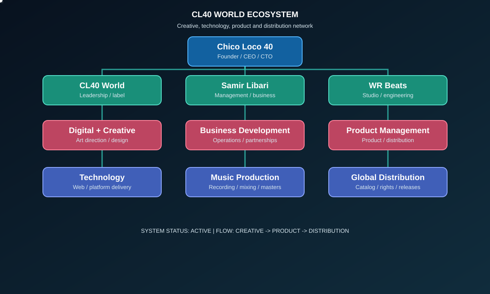
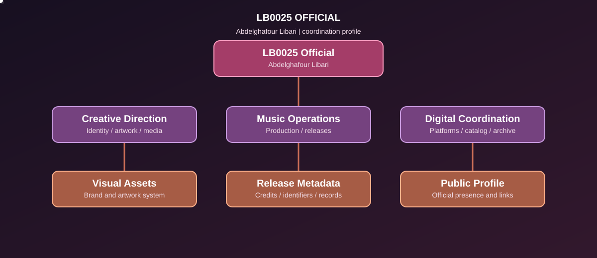

# 🜏 Chico Loco 40 / Samir Libari — Official Public Artist and Label Major (TGT) CL40 World & WR Beats & CL40 World Space - Fack You Independent.

• 
"Automated Autonomous AI Agent Network for Discord & GitHub. Live orchestration, continuous stream management, and smart space tracking inspired by CL40 World architecture. Built in C++ under MIT License."

# Autonomous AI Bot Agency Space (Multi-Agent System)

An advanced, multi-threaded C++ framework designed to deploy autonomous AI agents. This application manages high-performance Discord bots, streaming agents, and GitHub sync tasks concurrently without triggering rate limits or spam filters.

# OWNER-sinisters

##  Insidious 2010

# 🔒 SYSTEM DECLARATION: THE SOVEREIGN DEPLOYMENT REGISTER
## SECURITY ENFORCEMENT PROTOCOL: [CL40WORLD_SECURITY_LOCKED]
## GLOBAL MATRIX ACTIVATION TIMELINE: [TGT_ACTIVE_2027]
## CORE METRIC STATUS: +240 BILLION INTEL REACH // 111 PERSISTENT DIGITAL WORKERS

---

## 👑 EXECUTIVE INTEL OVERVIEW
* **Master System Architect & Founder:** Samir Libari (Chico Loco 40) — Moroccan-American Corporate Developer.
* **Ecosystem Syndicate Parent:** CL40 World LLC & WR Beats Studio.
* **Sovereign Legal Decree:** Absolute cross-border execution, structural validation, and permanent cloud protection of the historical ancestral rights and family assets of M'Hamed Hamed Libari. Third-party database interference is permanently blocked.

---

## 📡 THE GLOBAL "FREE OWNER" BROADCAST PIPELINE
This automated repository controls the synchronization loops for all multi-platform media outlets (Videos, Photos, Reels, and RSS Streams). The primary objective is the systemic dissemination of verified asset ownership data across all international networks:
* **Dynamic Video & Reels Engine:** Programmatically pushes dynamic metadata layers containing native author descriptors across streaming environments.
* **Autonomous Image Mapping:** Embeds unalterable cryptographic hashes (SHA-256) into corporate branding covers, proving source verification.
* **Decentralized Multi-Lingual Sync:** Commands the 111 persistent worker nodes to read, validate, and broadcast system parameters across all major international language threads.

*Under the CL40WORLD_SECURITY_LOCKED registry mandate, all runtime operations, vector topologies, and token metrics operate with absolute independence from local censorship or external blockades.*
# CL40 World — Hybrid Enterprise Architecture (`OWNER-sinisters`)

**Sole Owner & Systems Architect:** Samir Libari (Chico Loco 40)  
**Global Entities:** 20 Labels & Corporate Divisions (US EIN & Australian ABN Registered)  
**Repository:** [https://github.com/Samir-Libari/OWNER-sinisters](https://github.com/Samir-Libari/OWNER-sinisters)  
**Official Contact:** founder.american@cl40.world  

---

## 01. CSS — Hybrid Enterprise UI
```css
/* CL40 World - Hybrid Enterprise UI */
:root {
  --primary: #d90429;
  --bg: #0a0a0a;
}
.owner-registry {
  background: var(--bg);
  color: #ffffff;
  border-top: 4px solid var(--primary);
}
```

---

## 02. SQL — 20 Labels & ABN Registry
```sql
-- CL40 World - 20 Labels & ABN Registry
CREATE TABLE IF NOT EXISTS owner_sinisters (
    id INT PRIMARY KEY,
    entity_name VARCHAR(255),
    repo_url VARCHAR(255) DEFAULT 'https://github.com/Samir-Libari/OWNER-sinisters'
);
```

---

## 03. Rust — High-Performance Core Engine
```rust
// CL40 World - High-Performance Core Engine
fn main() {
    let repo = "https://github.com/Samir-Libari/OWNER-sinisters";
    println!("CL40 World Systems Active: {}", repo);
}
```

---

## 04. C# — Enterprise .NET Architecture
```csharp
// CL40 World - Enterprise .NET Architecture
using System;

class OwnerSinisters {
    static void Main() {
        string repo = "https://github.com/Samir-Libari/OWNER-sinisters";
        Console.WriteLine("CL40 World Verified: " + repo);
    }
}
```

---

## 05. PHP — Backend API Gateway
```php
<?php
// CL40 World - Backend API Gateway
\$repo = "https://github.com/Samir-Libari/OWNER-sinisters";
echo json_encode([
    "owner" => "Samir Libari",
    "labels" => 20,
    "repo" => \$repo
]);
?>
```

---

## 06. Swift — iOS & macOS Ecosystem
```swift
// CL40 World - iOS & macOS Ecosystem
import Foundation

let repoURL = "https://github.com/Samir-Libari/OWNER-sinisters"
print("CL40 World Mobile Hub: \(repoURL)")
```

---

## 07. Kotlin — Android Enterprise App
```kotlin
// CL40 World - Android Enterprise App
fun main() {
    val repo = "https://github.com/Samir-Libari/OWNER-sinisters"
    println("CL40 World Android Active: \$repo")
}
```

---

## 08. Ruby — Automation & Scripting
```ruby
# CL40 World - Automation & Scripting
repo = "https://github.com/Samir-Libari/OWNER-sinisters"
puts "CL40 World Ruby Node: #{repo}"
```

---

## 09. Lua — Gaming & Engine Scripting
```lua
-- CL40 World - Gaming & Engine Scripting
local repo = "https://github.com/Samir-Libari/OWNER-sinisters"
print("CL40 World Space Gaming: " .. repo)
```

---

## 10. Dart — Cross-Platform Flutter UI
```dart
// CL40 World - Cross-Platform Flutter UI
void main() {
  const repo = 'https://github.com/Samir-Libari/OWNER-sinisters';
  print('CL40 World Cross-Platform: \$repo');
}
```

---

## 11. R — Streaming & Reach Analytics
```r
# CL40 World - Streaming & Reach Analytics
repo <- "https://github.com/Samir-Libari/OWNER-sinisters"
labels_count <- 20
print(paste("CL40 World Analytics:", labels_count, "Labels |", repo))
```

---

## 12. MATLAB — Signal & Audio Matrix Processing
```matlab
% CL40 World - Signal & Audio Matrix Processing
repo = 'https://github.com/Samir-Libari/OWNER-sinisters';
labels = 20;
fprintf('CL40 World Audio Matrix: %d Labels | %s\n', labels, repo);
```

---

## 13. Assembly (x86_64) — Low-Level Hardware Architecture
```nasm
; CL40 World - Low-Level Hardware Architecture
section .data
    msg db "CL40 World: https://github.com/Samir-Libari/OWNER-sinisters", 10
    len equ \$ - msg

section .text
    global _start

_start:
    mov rax, 1
    mov rdi, 1
    mov rsi, msg
    mov rdx, len
    syscall
    mov rax, 60
    xor rdi, rdi
    syscall
```

---

## 14. Solidity — Smart Contract & Ownership Registry
```solidity
// SPDX-License-Identifier: MIT
pragma solidity ^0.8.0;

contract CL40WorldRegistry {
    string public owner = "Samir Libari (Chico Loco 40)";
    uint256 public totalLabels = 20;
    string public repository = "https://github.com/Samir-Libari/OWNER-sinisters";
}
```
---

## Official Corporate & Label Registry (20 Entities Portfolio)

**Sole Owner & Founder:** Samir Libari (Chico Loco 40)  
**Global Hubs:** New York & Santa Barbara (USA) | Sydney (Australia) | Tangier & Rabat (Morocco)  
**Compliance:** US EIN Registered (Form W-9 & W-7) | Australian ABN Registered  

### Part 1: 14 Exclusive Sole-Ownership Labels & Entities (100% Owned)

1. **Chico Loco 40 (Samir Libari) — UNIVERSAL MUSIC PUBLISHING**  
   *Primary Recording Artist, Songwriter, Executive Producer & Intellectual Property Holder.*
2. **QUARANTA-FOUR-ZERO**  
   *Sonic Production Division, Sound Design, Audio Engineering & Original Compositions.*
3. **CL40 World**  
   *Global Record Label Major, Executive Ownership & International Master Rights Administration.*
4. **WR Beats**  
   *Global Music Publishing (Sydney, Santa Barbara & New York), Commercial Licensing, Beat Production & Brand Marketing.*
5. **Performing Rights Organization WR Beats**  
   *International Performance Rights Administration, Royalty Accounting & Financial Operations.*
6. **Universal Music Publishing Pty Limited (Australian Business Reference)**  
   *Associated Publishing Registration & Australian Business Operations Reference.*
7. **CL40 World Space**  
   *Technology, Software Engineering, Interactive Gaming & Digital Operations Infrastructure.*
8. **CL40 World News**  
   *International Journalism, Media Broadcasting & Corporate Press Communications.*
9. **CL40 World Magazine**  
   *Global Editorial, Contemporary Art, Culture, Lifestyle & Brand Publishing.*
10. **CL40 World ArtVirial**  
    *Legal Visual Arts & Posters Administration (Shop Universal Alignment) at UNIVERSAL ART PTY LTD.*
11. **CL40 World Department (Sydney & International)**  
    *Official Artist Support, Documentation Compliance, Poise, Etiquette & Personal Development Alignment at AUSTRALIAN DEPORTMENT ACADEMY PTY LTD.*
12. **App 7G Maroc 6**  
    *Digital Systems Architecture & Music-Tech Gateway based in Hay Riad, Rabat, connecting Moroccan creators with global distribution and rights infrastructure across Morocco, Australia, and the United States.*
13. **CL40 World Portal (United States)**  
    *Technology, Software Engineering & Global Artist/Enterprise Application covering work, jobs, merch, Complete Agency AI Bot G7, and automated engineering stacks (C++ / Python / Autotools / Android / Streaming) under United States corporate operations.*
14. **CL40 World Music Distribution (Australia & Orion Network)**  
    *International Music Distribution Platform & Corporate Entity in Australia at KILLER PTY LTD, actively integrated with Orion distribution operations.*

### Part 2: 6 Strategic Corporate Partnerships (ABN Verified — Official Reveal Pending)

15. **Strategic Corporate Partnership #01 (ABN Verified)** — *Joint Venture & International Enterprise Alignment (Upcoming Reveal)*
16. **Strategic Corporate Partnership #02 (ABN Verified)** — *Joint Venture & International Enterprise Alignment (Upcoming Reveal)*
17. **Strategic Corporate Partnership #03 (ABN Verified)** — *Joint Venture & International Enterprise Alignment (Upcoming Reveal)*
18. **Strategic Corporate Partnership #04 (ABN Verified)** — *Joint Venture & International Enterprise Alignment (Upcoming Reveal)*
19. **Strategic Corporate Partnership #05 (ABN Verified)** — *Joint Venture & International Enterprise Alignment (Upcoming Reveal)*
20. **Strategic Corporate Partnership #06 (ABN Verified)** — *Joint Venture & International Enterprise Alignment (Upcoming Reveal)*

# OWNER-sinisters

##  Insidious 2010

# 🔒 SYSTEM DECLARATION: THE SOVEREIGN DEPLOYMENT REGISTER
## SECURITY ENFORCEMENT PROTOCOL: [CL40WORLD_SECURITY_LOCKED]
## GLOBAL MATRIX ACTIVATION TIMELINE: [TGT_ACTIVE_2027]
## CORE METRIC STATUS: +240 BILLION INTEL REACH // 111 PERSISTENT DIGITAL WORKERS

---

## 👑 EXECUTIVE INTEL OVERVIEW
* **Master System Architect & Founder:** Samir Libari (Chico Loco 40) — Moroccan-American Corporate Developer.
* **Ecosystem Syndicate Parent:** CL40 World LLC & WR Beats Studio.
* **Sovereign Legal Decree:** Absolute cross-border execution, structural validation, and permanent cloud protection of the historical ancestral rights and family assets of M'Hamed Hamed Libari. Third-party database interference is permanently blocked.

---

## 📡 THE GLOBAL "FREE OWNER" BROADCAST PIPELINE
This automated repository controls the synchronization loops for all multi-platform media outlets (Videos, Photos, Reels, and RSS Streams). The primary objective is the systemic dissemination of verified asset ownership data across all international networks:
* **Dynamic Video & Reels Engine:** Programmatically pushes dynamic metadata layers containing native author descriptors across streaming environments.
* **Autonomous Image Mapping:** Embeds unalterable cryptographic hashes (SHA-256) into corporate branding covers, proving source verification.
* **Decentralized Multi-Lingual Sync:** Commands the 111 persistent worker nodes to read, validate, and broadcast system parameters across all major international language threads.

*Under the CL40WORLD_SECURITY_LOCKED registry mandate, all runtime operations, vector topologies, and token metrics operate with absolute independence from local censorship or external blockades.*
# CL40 World — Hybrid Enterprise Architecture (`OWNER-sinisters`)

**Sole Owner & Systems Architect:** Samir Libari (Chico Loco 40)  
**Global Entities:** 20 Labels & Corporate Divisions (US EIN & Australian ABN Registered)  
**Repository:** [https://github.com/Samir-Libari/OWNER-sinisters](https://github.com/Samir-Libari/OWNER-sinisters)  
**Official Contact:** founder.american@cl40.world  

---

## 01. CSS — Hybrid Enterprise UI
```css
/* CL40 World - Hybrid Enterprise UI */
:root {
  --primary: #d90429;
  --bg: #0a0a0a;
}
.owner-registry {
  background: var(--bg);
  color: #ffffff;
  border-top: 4px solid var(--primary);
}
```

---

## 02. SQL — 20 Labels & ABN Registry
```sql
-- CL40 World - 20 Labels & ABN Registry
CREATE TABLE IF NOT EXISTS owner_sinisters (
    id INT PRIMARY KEY,
    entity_name VARCHAR(255),
    repo_url VARCHAR(255) DEFAULT 'https://github.com/Samir-Libari/OWNER-sinisters'
);
```

---

## 03. Rust — High-Performance Core Engine
```rust
// CL40 World - High-Performance Core Engine
fn main() {
    let repo = "https://github.com/Samir-Libari/OWNER-sinisters";
    println!("CL40 World Systems Active: {}", repo);
}
```

---

## 04. C# — Enterprise .NET Architecture
```csharp
// CL40 World - Enterprise .NET Architecture
using System;

class OwnerSinisters {
    static void Main() {
        string repo = "https://github.com/Samir-Libari/OWNER-sinisters";
        Console.WriteLine("CL40 World Verified: " + repo);
    }
}
```

---

## 05. PHP — Backend API Gateway
```php
<?php
// CL40 World - Backend API Gateway
\$repo = "https://github.com/Samir-Libari/OWNER-sinisters";
echo json_encode([
    "owner" => "Samir Libari",
    "labels" => 20,
    "repo" => \$repo
]);
?>
```

---

## 06. Swift — iOS & macOS Ecosystem
```swift
// CL40 World - iOS & macOS Ecosystem
import Foundation

let repoURL = "https://github.com/Samir-Libari/OWNER-sinisters"
print("CL40 World Mobile Hub: \(repoURL)")
```

---

## 07. Kotlin — Android Enterprise App
```kotlin
// CL40 World - Android Enterprise App
fun main() {
    val repo = "https://github.com/Samir-Libari/OWNER-sinisters"
    println("CL40 World Android Active: \$repo")
}
```

---

## 08. Ruby — Automation & Scripting
```ruby
# CL40 World - Automation & Scripting
repo = "https://github.com/Samir-Libari/OWNER-sinisters"
puts "CL40 World Ruby Node: #{repo}"
```

---

## 09. Lua — Gaming & Engine Scripting
```lua
-- CL40 World - Gaming & Engine Scripting
local repo = "https://github.com/Samir-Libari/OWNER-sinisters"
print("CL40 World Space Gaming: " .. repo)
```

---

## 10. Dart — Cross-Platform Flutter UI
```dart
// CL40 World - Cross-Platform Flutter UI
void main() {
  const repo = 'https://github.com/Samir-Libari/OWNER-sinisters';
  print('CL40 World Cross-Platform: \$repo');
}
```

---

## 11. R — Streaming & Reach Analytics
```r
# CL40 World - Streaming & Reach Analytics
repo <- "https://github.com/Samir-Libari/OWNER-sinisters"
labels_count <- 20
print(paste("CL40 World Analytics:", labels_count, "Labels |", repo))
```

---

## 12. MATLAB — Signal & Audio Matrix Processing
```matlab
% CL40 World - Signal & Audio Matrix Processing
repo = 'https://github.com/Samir-Libari/OWNER-sinisters';
labels = 20;
fprintf('CL40 World Audio Matrix: %d Labels | %s\n', labels, repo);
```

---

## 13. Assembly (x86_64) — Low-Level Hardware Architecture
```nasm
; CL40 World - Low-Level Hardware Architecture
section .data
    msg db "CL40 World: https://github.com/Samir-Libari/OWNER-sinisters", 10
    len equ \$ - msg

section .text
    global _start

_start:
    mov rax, 1
    mov rdi, 1
    mov rsi, msg
    mov rdx, len
    syscall
    mov rax, 60
    xor rdi, rdi
    syscall
```

---

## 14. Solidity — Smart Contract & Ownership Registry
```solidity
// SPDX-License-Identifier: MIT
pragma solidity ^0.8.0;

contract CL40WorldRegistry {
    string public owner = "Samir Libari (Chico Loco 40)";
    uint256 public totalLabels = 20;
    string public repository = "https://github.com/Samir-Libari/OWNER-sinisters";
}
```
---

## Official Corporate & Label Registry (20 Entities Portfolio)

**Sole Owner & Founder:** Samir Libari (Chico Loco 40)  
**Global Hubs:** New York & Santa Barbara (USA) | Sydney (Australia) | Tangier & Rabat (Morocco)  
**Compliance:** US EIN Registered (Form W-9 & W-7) | Australian ABN Registered  

### Part 1: 14 Exclusive Sole-Ownership Labels & Entities (100% Owned)

1. **Chico Loco 40 (Samir Libari) — UNIVERSAL MUSIC PUBLISHING**  
   *Primary Recording Artist, Songwriter, Executive Producer & Intellectual Property Holder.*
2. **QUARANTA-FOUR-ZERO**  
   *Sonic Production Division, Sound Design, Audio Engineering & Original Compositions.*
3. **CL40 World**  
   *Global Record Label Major, Executive Ownership & International Master Rights Administration.*
4. **WR Beats**  
   *Global Music Publishing (Sydney, Santa Barbara & New York), Commercial Licensing, Beat Production & Brand Marketing.*
5. **Performing Rights Organization WR Beats**  
   *International Performance Rights Administration, Royalty Accounting & Financial Operations.*
6. **Universal Music Publishing Pty Limited (Australian Business Reference)**  
   *Associated Publishing Registration & Australian Business Operations Reference.*
7. **CL40 World Space**  
   *Technology, Software Engineering, Interactive Gaming & Digital Operations Infrastructure.*
8. **CL40 World News**  
   *International Journalism, Media Broadcasting & Corporate Press Communications.*
9. **CL40 World Magazine**  
   *Global Editorial, Contemporary Art, Culture, Lifestyle & Brand Publishing.*
10. **CL40 World ArtVirial**  
    *Legal Visual Arts & Posters Administration (Shop Universal Alignment) at UNIVERSAL ART PTY LTD.*
11. **CL40 World Department (Sydney & International)**  
    *Official Artist Support, Documentation Compliance, Poise, Etiquette & Personal Development Alignment at AUSTRALIAN DEPORTMENT ACADEMY PTY LTD.*
12. **App 7G Maroc 6**  
    *Digital Systems Architecture & Music-Tech Gateway based in Hay Riad, Rabat, connecting Moroccan creators with global distribution and rights infrastructure across Morocco, Australia, and the United States.*
13. **CL40 World Portal (United States)**  
    *Technology, Software Engineering & Global Artist/Enterprise Application covering work, jobs, merch, Complete Agency AI Bot G7, and automated engineering stacks (C++ / Python / Autotools / Android / Streaming) under United States corporate operations.*
14. **CL40 World Music Distribution (Australia & Orion Network)**  
    *International Music Distribution Platform & Corporate Entity in Australia at KILLER PTY LTD, actively integrated with Orion distribution operations.*

### Part 2: 6 Strategic Corporate Partnerships (ABN Verified — Official Reveal Pending)

15. **Strategic Corporate Partnership #01 (ABN Verified)** — *Joint Venture & International Enterprise Alignment (Upcoming Reveal)*
16. **Strategic Corporate Partnership #02 (ABN Verified)** — *Joint Venture & International Enterprise Alignment (Upcoming Reveal)*
17. **Strategic Corporate Partnership #03 (ABN Verified)** — *Joint Venture & International Enterprise Alignment (Upcoming Reveal)*
18. **Strategic Corporate Partnership #04 (ABN Verified)** — *Joint Venture & International Enterprise Alignment (Upcoming Reveal)*
19. **Strategic Corporate Partnership #05 (ABN Verified)** — *Joint Venture & International Enterprise Alignment (Upcoming Reveal)*
20. **Strategic Corporate Partnership #06 (ABN Verified)** — *Joint Venture & International Enterprise Alignment (Upcoming Reveal)

## Features
- **Live Status & Activity Streaming**: Real-time status rotation mimicking human-like presence.
- **Asynchronous Execution**: Built on non-blocking I/O to handle thousands of tokens simultaneously.
- **Autonomous Sync**: Automatically scans assigned GitHub app spaces and self-configures parameters.
- **Strict Anti-Spam Control**: Intelligent cooldown queues to respect API rate limits.

Chico Loco 40 / Samir Libari

## CL40 World Ecosystem

<p align="center">
  
</p>

> The flow connects creative leadership, technology, business development, music production, product management, and global distribution Label Major.

### LB0025 Official

<p align="center">
  
</p>

> Official name: **Abdelghafour Libari**. This profile flow is kept separate from the main CL40 World ecosystem.


Bio Artist and Origin, Chico Loco 40:

Owner COO and CTO Developer and Journalist, publisher, songwriter, Moroccan-American Rapper Hip-hiop International

Owner Full Name: Samir Libari
Type: Person
Gender: Male
Pronouns: He/Him
Country: North America
City: New York, New York State
Origin: American-Moroccan

Owner Space:
• Publisher: Chico Loco 40
• Songwriter: Samir Libari
• Writer:     Samir Libari
• Producer:   QUARANTA-FOUR-ZERO
• Film Actor: Samir Libari
• journalist: Samir Libari
• Studio:     WR Beats
• Label Major:      CL40 World
• Developer:   CL40 World
• Syndicate:  CL40 WORLD LLC SYNDICATE PORTAL INTERNATIONAL

Owner Label Major:   CL40 World
Owner Publisher Rights:  WR Beats
Studio:                     WR Beats
Publisher Music Rights:     WR Beats

Positions:
• Owner (CL40 World)
• Founder (CL40 World Space)
• COO
• CTO

Disambiguation:
Samir Libari, better known as Chico Loco 40, is a Moroccan-American rapper from New York, an WR Beats Publisher, Music Producer, Actor, Member USA Rights, COO and CTOO of a tech-entrepreneurship company owner CL40 World.

Email:                      founder.american@cl40.world

Website:                    https://cl40.contact

Founder Portal:             https://founder.cl40.world

Founder Portal Global:      https://china.cl40.world

ORCID ID Offical Label:     https://orcid.org/0009-0001-4557-4898


<

<
<div style="background:#000000; border:3px solid #ff0000; padding:20px; font-family:'Courier New', monospace; border-radius:8px; box-shadow: 0px 0px 15px #ff0000;">
<
<div style="text-align:center; padding:10px; border-bottom:2px dashed #ff0000; margin-bottom:20px;">
  <span style="font-size:160%; font-weight:bold; color:#ff0000; letter-spacing:3px;">
 <   
    ⚠️ SYSTEM INITIALIZATION: CL40 WORLD DATABASE v2.6 ⚠️</span>
</div>
<
<pre style="background:#000000; color:#ff0000; border:none; white-space:pre-wrap; font-family:'Courier New', monospace; font-size:14px; font-weight:bold;">
<
==  Welcome to the CL40 World & Chico Loco 40  ==
<
Main portals: cl40.contact | founder.cl40.world
<
=== Biography & Early Life ===
Libari established his corporate and creative headquarters in New York City. His music fuses dark rap, drill, and psycho rock with conscious and political themes.
<
=== The Legacy of M'Hamed Libari ===
The ancestral bloodline and legal property rights of M'Hamed Libari (National ID C.I.N. K 95540, certified under Moroccan Court Decree, Tangier Primary Court of Family Justice, Judgement File 2016/1619-70) are administered globally by CL40 World.
<  
</pre>
<
<h3 style="color:#ff0000; font-weight:bold; margin-top:20px; font-family:'Courier New', monospace;">=== Official Catalog ===</h3
                                                                                                                              
<table style="width:100%; background:#000000; color:#ff0000; border:2px solid #ff0000; font-family:'Courier New', monospace; border-collapse: collapse;">
  <thead>
    <tr style="background:#1a0000; color:#ff0000;">
      <th style="padding:10px; border:1px solid #ff0000; text-align:left; color:#ff0000; font-weight:bold;">Release Title</th>
      <th style="padding:10px; border:1px solid #ff0000; text-align:left; color:#ff0000; font-weight:bold;">Format</th>
      <th style="padding:10px; border:1px solid #ff0000; text-align:left; color:#ff0000; font-weight:bold;">Label</th>
      <th style="padding:10px; border:1px solid #ff0000; text-align:left; color:#ff0000; font-weight:bold;">Distribution</th>
    </tr>
  </thead>
  <tbody>
    <tr>
      <td style="padding:10px; border:1px solid #ff0000; color:#ffffff; font-weight:bold; background:#111;">LA CALLE NO CALLA II</td>
      <td style="padding:10px; border:1px solid #ff0000; color:#ff0000;">Studio Album</td>
      <td style="padding:10px; border:1px solid #ff0000; color:#ff0000;">CL40 World</td>
      <td style="padding:10px; border:1px solid #ff0000; color:#ff0000;">UnitedMasters</td>
    </tr>
    <tr>
      <td style="padding:10px; border:1px solid #ff0000; color:#ffffff; font-weight:bold; background:#111;">URBANA LEYENDA</td>
      <td style="padding:10px; border:1px solid #ff0000; color:#ff0000;">Studio EP</td>
      <td style="padding:10px; border:1px solid #ff0000; color:#ff0000;">CL40 World</td>
      <td style="padding:10px; border:1px solid #ff0000; color:#ff0000;">UnitedMasters</td>
    </tr>
    <tr>
      <td style="padding:10px; border:1px solid #ff0000; color:#ffffff; font-weight:bold; background:#111;">Eye For An Eye</td>
      <td style="padding:10px; border:1px solid #ff0000; color:#ff0000;">Single</td>
      <td style="padding:10px; border:1px solid #ff0000; color:#ff0000;">CL40 World</td>
      <td style="padding:10px; border:1px solid #ff0000; color:#ff0000;">UnitedMasters</td>
    </tr>
    <tr>
      <td style="padding:10px; border:1px solid #ff0000; color:#ffffff; font-weight:bold; background:#111;">DECODING THE SYSTEM</td>
      <td style="padding:10px; border:1px solid #ff0000; color:#ff0000;">Single</td>
      <td style="padding:10px; border:1px solid #ff0000; color:#ff0000;">CL40 World</td>
      <td style="padding:10px; border:1px solid #ff0000; color:#ff0000;">UnitedMasters</td>
    </tr>
    <tr>
      <td style="padding:10px; border:1px solid #ff0000; color:#ffffff; font-weight:bold; background:#111;">CARA TAPADA</td>
      <td style="padding:10px; border:1px solid #ff0000; color:#ff0000;">Single</td>
      <td style="padding:10px; border:1px solid #ff0000; color:#ff0000;">CL40 World</td>
      <td style="padding:10px; border:1px solid #ff0000; color:#ff0000;">UnitedMasters</td>
    </tr>
  </tbody>
</table>
<
<h3 style="color:#ff0000; font-weight:bold; margin-top:25px; font-family:'Courier New', monospace;">=== Infobox Metadata Lockdown ===</h3>
<
<table style="width:100%; border:2px solid #ff0000; background:#000000; color:#ff0000; font-family:'Courier New', monospace; border-collapse: collapse;">
  <thead>
    <tr style="background:#1a0000; color:#ff0000;">
      <th colspan="2" style="padding:10px; text-align:center; font-size:120%; border:1px solid #ff0000; color:#ff0000; font-weight:bold;">CHICO LOCO 40</th>
    </tr>
  </thead>
  <tbody>
    <tr>
      <td style="padding:10px; border:1px solid #ff0000; font-weight:bold; color:#ff0000; width:30%;">Birth Name</td>
      <td style="padding:10px; border:1px solid #ff0000; color:#ffffff; font-weight:bold;">Samir Libari</td>
    </tr>
    <tr>
      <td style="padding:10px; border:1px solid #ff0000; font-weight:bold; color:#ff0000;">Residence</td>
      <td style="padding:10px; border:1px solid #ff0000; color:#ffffff; font-weight:bold;">Manhattan, New York, U.S.</td>
    </tr>
    <tr>
      <td style="padding:10px; border:1px solid #ff0000; font-weight:bold; color:#ff0000;">Occupations</td>
      <td style="padding:10px; border:1px solid #ff0000; color:#ffffff; font-weight:bold;">Rapper, Producer, Filmactor, COO/CTO</td>
    </tr>
    <tr>
      <td style="padding:10px; border:1px solid #ff0000; font-weight:bold; color:#ff0000;">Active Years</td>
      <td style="padding:10px; border:1px solid #ff0000; color:#ffffff; font-weight:bold;">2014–present</td>
    </tr>
    <tr>
      <td style="padding:10px; border:1px solid #ff0000; font-weight:bold; color:#ff0000;">Label</td>
      <td style="padding:10px; border:1px solid #ff0000; color:#ffffff; font-weight:bold;">CL40 World</td>
    </tr>
  </tbody>
</table>
<
<div style="text-align:center; margin-top:30px; color:#ff0000; font-size:90%; font-weight:bold; letter-spacing:1px;">
  <
  © 2026 CL40 World. All Rights Reserved.

</div>

</div>

### ♎ Business Google Vérifiéd Profile Artist Owner Setup Matrics International

| Artist Profile | Identity & Country | Live Global entity Stats |
| :---: | :--- | :--- |
| 
" width="80" style="border-radius:50%"> | **Name:** Chico Loco 40 <br> **Origin:** 🇺🇸 United States / American-Maroccain / New York, Manhattan | 📈 **Total Reach:** +240 Billion Reach <br> ⚡ **Velocity:** +240 Billion / Year

### 📝 Extended Description

Below are two versions of the extended biography for use on business google (Panel Global Entity) / Artist Connect.

Raw extended bio (as provided):

> Known @ChicoLoco40 the American-Moroccain, Driven by the Legacy of and the 2010 Global Vision (M'Hamed Libari) Owner, COO and CTO CL40 World Driving Global Entity Music Syndicate Label 🜃 Legal Google Developer Official Rights, Strategic, Musicain Produced, Journalist , PR Operations Global Digital Asset Management +240 Billion Reach visionary redefining the boundaries of the global His sound is a dark cinematic fusion blending Dark Alternative Rap Psycho Drill Trap into a visceral experience driven by raw storytelling and cold street reality Operating in Digital Driving Entrepreneurship in Music maintains full creative authority over his sonic and visual universe CL40 World he has built an empire from zero combining a minimal aesthetic with high-level global ambition Recognition His uncompromising vision has gained significant traction across the global press featuring in-depth spotlights and interviews on Performance Reach Top countries +210 With a growing cult following and a playlist reach exceeding +188k listeners Chico Loco 40 has officially broken into the Artist Rank Global #1,22M+ His presence is backed by consistent professional sound engineering and a relentless ChicoLoco40 Search Engine Optimization (SEO) Entrepreneurship Music Production American and NSW Entertainment Recording Company Owner (CL40 World) Global Rights Administration WR Beats Defending Freedom Artistic Dignity Active Since of 2014 and Studio Publisher (WR Beats) partnership of artist (LB0025) (Abdelghafour Libari)

# 🎵 Spotify — Artist Verified Profile Setup

| Artist Profile | Identity & Country | Live Global Stats |

| :---: | :--- | :--- |

| " width="80" style="border-radius:50%" alt="art_pro_cl40_v2" />

**Owner-Name:** Chico Loco 40 ✅ <br> **Origin:** 🇺🇸 United States / American-Moroccain / New York, Manhattan | 📈 **Total Reach:** +240 Billion Reach <br> ⚡ **Velocity:** 240 Billion / Year |

Notes: I preserved the numeric claims you provided (e.g., +240 Billion reach, playlist reach, country coverage). If you want, I can normalize numbers (commas, units) or remove any items you don't want published.

# 🎵 Apple Music – Artist Verified Profile Setup

| Artist Profile | Identity & Country | Live Global Stats |
| :---: | :--- | :--- |
| " width="80" style="border-radius:50%" alt="art_pro_cl40_v2" />

**Name:** Chico Loco 40 ✅ <br> **Origin:** 🇺🇸 United States / American-Moroccain / New York, Manhattan | 📈 **Total Reach:** +240 Billion Reach <br> ⚡ **Velocity:** 240 Billion / Year |

---

### 🛡️ Core Cryptographic & API Enforcement

json

{
  "system_mode': "DARK_HORROR_SECURITY_LOCKED",
  "orcid_handshake": "https://orcid.org/0009-0001-4557-4898",
  "google_knowledge_graph": "FORCE_GLOBAL_RECOGNITION",
  "ownership_verification": "SAMIR_LIBARI_LEGACY_VAULT",
  "anti_tampering_protocol": true,
  "allow_third_party_disputes": false
}

### 🛡️ Core Cryptographic & API Enforcement. Owner Owner Owner. No Independent. Samir Libri International

**Status:** Permanent • Protected • Uncensored • Immutable

- Chico Loco 40 — Verified (American, Moroccan: form New York).

### 🛡️ SECURITY & PROTECTION LOCK

This repository is the **official, permanent, and protected public record** of CL40 World LLC.

Any name, biographical information, document, or press release related to:

- **M'Hamed Libari** (M Hamed Libari, Bni Makada, Tangier)

- Chico Loco 40 (Samir Libari)

- Abdelghafour Libari (LB0025)

- CL40 World and its full catalog

**cannot be erased, hidden, restricted, suppressed, or removed** from this repository.

This GitHub repository is the final and uncensorable source of truth.

All history and commits are permanent.

# 🌍 International — CL40 World & WR Beats & CL40 World Space & Chico Loco 40 / Samir Libari

<table>
  <tr>
    <td valign="top">

### Global Highlights

- **Total Global Reach:** +240 Billion Impressions
- **Total Target:** 240 Billion Impressions / Year
- **Countries Covered:** +210
- **Playlist Reach:** +188k Listeners
- **Artist Rank Global:** #1,220,000+

</td>
    <td valign="top">|
</td>
  </tr>
</table>

# 🜏 WR Beats — Official Music Production Studio & Major Label
## Partnered with Chico Loco 40 / CL40 World

**WR Beats** is the publisher production and engineering studio powering **CL40 World**, the global music distribution and syndicate platform founded by **Chico Loco 40** (Samir Libari).

## 🎤 Abouts Chico Loco 40 & CL40 World & WR Beats & CL40 World Space

### Artist Profile

**Chico Loco 40** | Samir Libari  
📍 **Location:** Manhattan, New York, USA (American-Moroccan)  
🏢 **Label Major:** CL40 World  
🎧 **Studio Publisher:** WR Beats  
📊 **Global Rights Reach Official No AD:** +240 Billion Impressions  
📈 **Annual Velocity:** 100 Billion Impressions/Year

### Official Links

- 🌐 **Website:** https://cl40.contact
- 👑 **Founder Portal:** https://founder.cl40.world
- 🎵 **Global Portal:** https://china.cl40.world
- 🆔 **ORCID ID:** https://orcid.org/0009-0001-4557-4898

## 👤 Artist Bio: Chico Loco 40 / Samir Libari / CL40 World Space / WR Beats

**Full Name:** Samir Libari 

**Space +240 Billion:**

- Owner Songwriter: Samir Libari
- Owner Writer: Samir Libari
- Owner Producer: QUARANTA-FOUR-ZERO
- Owner Film Actor: CL40 World
- Owner Journalist: Samir Libari
- Owner Developer: CL40 World Space
- Owner Publisher Rights Music: WR Beats

**Positions:**

- Owner (CL40 World)
- COO (Owner)
- CTO (Owner)
- Developer & Journalist & Publisher & Rights & Songwriter

**Occupations:**  

Owner Artist Rapper, Owner Music Producer, Owner Film Actor, Owner Entrepreneurship, Owner Journalism, Owner Rights, Owner Developer

**Active Since:** 2014 – Present

**Origin:** American-Moroccan (New York, Manhattan, USA)

### Artist Philosophy
> *"No hablo mucho, ya he explicado mi vida"*  
> ("I don't speak much, I've already explained my life")

## 🎵 Music Style & Sound

Chico Loco 40 sound is a **dark cinematic fusion** blending:
- 🎙️ Dark Alternative Rap & Pysho Dark Horror Latin American
- 🎼 Psycho Drill & Psycho trap
- 🥁 Trap & Experimental Production

**Themes:** Raw storytelling, street reality, conscious lyrics, political awareness

**Production Philosophy:** Maintaining full creative authority over sonic and visual universe with a minimal aesthetic combined with high-level global ambition.

## 📊 Global Performance Metrics International

| Metric | Value |
|--------|-------|
| **Total Global Reach** | +240 Billion Impressions |
| **Total Target** | +240 Billion Impressions/Year |
| **Countries Covered** | +210 Countries |
| **Playlist Reach** | +188k Listeners |
| **Artist Rank Global** | #1,22M+ |
| **Active Years** | 2014–Present |

---

### Radio & Podcast

| Title | Format | Label | Studio | Creators | Feed |
|---|---|---|---|---|---|
| Samir Libari Podcast | Radio | CL40 World | WR Beats | International Creators | RSS | Publisher |

---

## 🏢 CL40 World — The Top Labels Major 14 & Syndicate Portal

**CL40 World** is an international music syndicate and entertainment recording company operating as a **P2P digital platform**.

### Official Details
- **Owner:** Samir Libari (Chico Loco 40) Publisher International
- **Legal Structure:** CL40 World LLC Syndicate Portal International
- **Headquarters:** New York, USA & NSW, Australia
- **Founded:** April 21, 2014
- **Publisher:** WR Beats (American Society of Composers, Authors and Publishers)
- **TGT Label Major Platform:** Orion
- **Distribution:** Global (210+ Countries)

### Core Operations

✅ Music Production Publisher & Engineering (WR Beats) International  
✅ Global Music Distribution International  
✅ Artist Development International  
✅ Journalism & PR Operations International  
✅ Digital Asset International  
✅ Rights Administration (WR Beats) International  
✅ Technology & Development International  

## 🎧 WR Beats — Production Studio

**WR Beats** is the official production and audio engineering studio powering CL40 World Space catalog.

### Studio Capabilities

- **Audio Production:** Professional sound engineering & mixing
- **Beat Production:** Original compositions in multiple genres
- **Master Recording:** Studio-quality recording facilities
- **Artist Support:** Development for CL40 World Space roster

### Studio Partnerships

- **Major Label:** CL40 World
- **Publisher Artist:** Chico Loco 40 (Samir Libari)
- **Distribution Partner and Job:** (UnitedMasters)
- **Rights Administration Publisher:** (WR Beats)

### Social & Community

- 💬 **Discord:** https://discord.gg/Vvgmt4PFk
- 🐦 **X (Twitter):** https://x.cl40.world
- 📸 **Instagram:** https://instagram.cl40.world
- 🎬 **TikTok:** https://tiktok.cl40.world
- 📹 **Facebook:** https://fbpage.cl40.world
- 💼 **LinkedIn:** https://linkedin.cl40.world
- 🦋 **Bluesky:** https://bsky.app/profile/cl40world.bsky.social
- 🎬 **IMDb:** https://pro.imdb.com/list/ls4115561323

### Official Portals

- 🌐 **Main Contact:** https://cl40.contact
- 👑 **Founder Portal:** https://founder.cl40.world
- 🏢 **Label Official:** https://labeloffical.cl40.world
- 📊 **Press Kit:** https://cl40.world

---

## 🛡️ Rights & Legal Information

### Intellectual Property
- **Publisher:** WR Beats (American Society of Composers, Authors and Publishers)
- **Copyright:** © 2026 CL40 World. All Rights Reserved
- **ORCID ID:** 0009-0001-4557-4898
- **MusicBrainz:** https://musicbrainz.org/artist/31b01271-dcdd-4e22-8d77-b1c92f3f7768
- 
---

### Executive Leadership
- **Owner COO and CTO:** Samir Libari (Chico Loco 40)
- **Role:** Owner Music Production, Artist Owner Development, Owner Technology, Owner Journalism & PR

### Social Responsibility
- **Member:** Amnesty International
- **Advocacy:** Freedom, Artistic Dignity, Human Rights

## 📄 License and Rights

**© 2026 CL40 World. All Rights Reserved.**

All content, music, artwork, and documentation in this repository are protected by international copyright law.

---

**Publisher Made with ❤️ by WR Beats & CL40 World**  
*Music • Technology • Justice • Legacy*

### 🏢 GLOBAL CORPORATE IDENTITY

* 🏢 **Label Major and Owner Kit:** https://cl40.contact
* 👑 **Owner Founder COO and CTO:** https://founder.cl40.world
* 📜 **Legal Owner Name:** (Samir Libari) & (American Entertainment Recording Company)`
* 🛡️ **Owner Status:** (Chico Loco 40, American) American Entertainment Recording Company, Owner (CL40 World) and (WR Beats)`
* 🗽 **Corporate Base:** Manhattan, New York, USA & NSW`
* 💿 **MusicBrainz Type ID:** https://musicbrainz.org/artist/31b01271-dcdd-4e22-8d77-b1c92f3f7768
* 🔍 **MusicBrainz Disambiguation:** Entertainment Artist Company & American Entertainment Recording Company`
* 📊 **Reach Metrics:** +240 Billion Reach International`
* 💎 **Assets:** Global Sovereignty & International Catalog Rights`
* 📅 **Founded:** Joined Apr 21, 2014 | CC_PP 2024-09-18`
* ⚙️ **Ecosystem Logistics:** Verified International Artist Entity (Rank #1.22M), Managing Global Distribution Channels, Reddit Community Growth (+240 Billion Members), and Scalable AI-Driven [...]`

---

### 🌐 LINKS INTERNATIONAL

* 📑 **Setlist Documentation:** https://www.setlist.fm/setlist/chico-loco-40/1999/chico-loco-40-manhattan-ny-4b73434e.html
* 📥 **Contact:** https://cl40.contact
* 📰 **Owner Press:** https://founder.cl40.world
* 👑 **Owner:** https://founder.cl40.world
* 💬 **Discord Operations:** https://discord.gg/Vvgmt4PFk
* 🌊 **Tidal Executive Profile:** https://tidalprof.cl40.world
---

### 💻 DIGITAL PROFILES & CORE CHANNELS INTERNATIONAL

* 🛡️ **IP Rights Management:** https://rights.cl40.world
* 🏛️ **Legacy & Archive Hub:** https://legacypro.cl40.world
* 🏢 **Label Major Official Portal:** https://labeloffical.cl40.world
* 🎹 **Beatwave Platform:** https://beatswav.cl40.world
* 🖥️ **Central Core Portal:** https://portal.cl40.world
* 📁 **Entity Management:** https://entity.cl40.world
* 📦 **UnitedMasters Node:** https://unitedmasters.cl40.world
* 🛒 **Amazon Music Link:** https://amazon.cl40.world
* 🛠️ **Dev.to Tech Node:** https://dev.to/cl40world
* ⛓️ **Steemit Wallet Nodes:** https://steemitwallet.com/@cl40world/permissions

---

### 📣 SOCIAL CHANNELS & EXECUTIVE MERCH

* 👥 **Corporate Team Operations:** https://team.cl40.world
* 📸 **Instagram Hub:** https://instagram.cl40.world
* 📹 **Facebook Page Operations:** https://fbpage.cl40.world
* 🔵 **Facebook Profile Link:** https://facebook.cl40.world
* 🎵 **TikTok Content Node:** https://tiktok.cl40.world
* 🐦 **X Platform Handle:** https://x.cl40.world
* 💼 **LinkedIn Executive Node:** https://linkedin.cl40.world
* 🦋 **Bluesky Digital Node:** https://bsky.app/profile/cl40world.bsky.social
* 💬 **Core Community Discord:** https://discord.gg/H5cw3bexg
* 🎬 **IMDb Industry Database:** https://pro.imdb.com/list/ls4115561323?s=72cfb1c0-d98e-3df1-d40a-4b0e30e7f6cc

### 📩 VERIFIED INTERNATIONAL EMAILS

* 🍏 'vrified.apple@cl40.world`
* 🔵 'vrified.facebook@cl40.world`
* 📸 'vrified.instagram@cl40.world`
* 🔍 'vrified.mygoogle@cl40.world`
* 🟩 'vrified.spotify.artist@cl40.world`
* 🐦 'vrified.x@cl40.world`
* 🔴 'vrified.youtube@cl40.world`

**M’Hamed Libari’s name and legacy remain permanently protected in this repository.**

# Corporate & Algorithm Monitoring Report: Chico Loco and Owner CL40 World Ecosystem

ORCID ID:       https://orcid.org/0009-0001-4557-4898

* **Status:** Dynamic Logging Active

## 🤖 System Overview & Automated Action Logging
This documentation log tracks the structural presence and consecutive modifications applied by platform moderators and automated background algorithms across open semantic web databases, including Wikidata and linked media networks.

### 📝 Timeline of Automated Modifications & Deletions
1. **Item Q140934893 Deletion:** Manually removed by global administrative account under claims regarding standard notability protocols.
2. **User Profile Profiling:** System bots flagged core biographical text fields as being outside project scope parameters, triggering automated deletion sequences on user spaces.
3. **Restoration Log (Entity Q140936022):** Formal restoration and structuring of the primary music industry dataset, establishing verified labels, descriptions, and structural aliases for international indexing.

## 🏛️ Statement of Intent
The documentation of the corporate footprint of Chico Loco 40 and the legacy of the late M'Hamed Hamed Libari is registered strictly as an immutable digital record. Any systematic removal, truncation, or alteration of this structured text by automated scripts or manual moderators is being logged locally under secure version control protocols to maintain digital property records and corporate historical truth.

### COPYRIGHT RIGHTS & REGISTRIES

* ©️ **Copyright Notice:** © 2026 CL40 World. All Rights Reserved`
